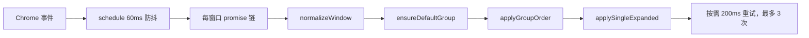

# agent.md

面向修改本仓库的编码代理。用户文档见 [README.md](README.md)。

## 目标与硬约束

- Chrome MV3 扩展，`minimum_chrome_version` 124；无构建步骤、无运行时依赖。
- 权限只有 `tabs`、`tabGroups`、`storage`。`tabs` 仅用于读取 `url` / `pendingUrl` 做新标签页分类。
- **永远不要存储、记录或发送 URL。** 固定分组快照只允许分组 ID、窗口 ID、标题、颜色、折叠状态、标签页 ID 和时间戳。
- `src/lib/*.js` 必须是纯函数，不调用 `chrome.*`；所有 Chrome API 调用集中在 `src/background.js` 和两个 UI 页面。
- 设置写入统一走后台：UI 发送 `{type:"save-settings", patch}`，由后台校验、必要时重命名默认分组，再写 `chrome.storage.sync.settings`。
- 用户可见文案使用中文；代码标识符和注释使用英文。
- 改完运行 `npm test`。脚本是 `node --test test/*.test.js`（Node 24 不接受裸 `test/` 目录参数）。

## 文件地图

| 文件 | 职责 |
| --- | --- |
| `manifest.json` | 权限、service worker module、选项页、弹窗、图标、`switch-to-default-group` 快捷键 |
| `icons/icon.svg` + PNG | 扩展图标源文件，改图后重新导出 16/32/48/128 |
| `src/background.js` | 事件接线、逐窗口串行归一化、启动门、固定分组保护、设置写入 |
| `src/lib/layout.js` | `planGroupOrder`、`planCollapse`、`planNewTabTarget`、默认分组查找与重复合并、NTP URL 判定 |
| `src/lib/pinned.js` | `isPinnedGroup`（标题+颜色）、`choosePinnedRestore`（`skip` / `regroup` / `blank`） |
| `src/lib/settings.js` | 默认值、标题/颜色/钉住列表校验、`loadSettings` / `saveSettings` |
| `src/options.*` | 分组式设置卡片、默认分组、钉住列表、快捷键展示与跳转 |
| `src/popup.*` | 分组数、当前分组、总开关、“立即整理”、“设置” |
| `test/*.test.js` | 纯逻辑回归测试 + 后台事件接线测试（fake chrome）。每个后台测试文件在独立进程里加载一次 `background.js`；需要全新 worker 的场景（如 `wake-*.test.js` 的唤醒路径）各占一个文件 |
| `test/fake-chrome.js` | 共享的 fake `chrome`：`installFakeChrome({ groups, tabs, settings, session, storageDelayMs })`，`failures.group/update` 注入一次性 API 失败，`closeTab` / `removeGroup` 模拟 Chrome 删除顺序 |
| `.github/workflows/release.yml` | tag 发布：测试、校验清单版本、打包 zip、上传 GitHub Release |
| `CHANGELOG.md` | 用户可见变更记录，版本号与 `manifest.json` 同步 |

## 必须维持的不变量

归一化完成后，每个普通窗口满足：

1. 钉住分组按配置顺序在最前；其余分组按当前顺序紧随；未分组标签页在所有分组之后。
2. 除固定标签页外，没有 `groupId === -1` 的标签页（`defaultGroup` 开启时）。
3. 恰好一个分组展开：活动标签页的分组；活动标签页是固定标签页时，`keepLastWhenPinned` 开启则为上次/最近使用的分组，否则全部折叠。
4. 新标签页按规则进入展开分组；Chrome 已归组的链接标签页不被抢走。
5. 钉住分组不会变空：最后一个标签页消失后以空白 NTP 重建，除非窗口正在关闭或分组被移动到其他窗口。

## 运行时结构



- 所有变更事件只调用 `schedule(windowId)`；`enqueue` 保证同一窗口串行。每一步都重新查询 tabs/groups，之前拿到的 ID 一律视为可能过期。
- `planGroupOrder` 的移动规则：先算出期望顺序，然后**逆序**把每个分组 `tabGroups.move(id, {index: pinnedCount})`。这样最终顺序正确，且所有分组位于未分组标签页之前。`pinnedCount` 是固定标签页数量，永远是一个合法插入点。
- `chrome.tabs.group` 绝对不能收到固定标签页：源码文档明确会把它取消固定。`ensureDefaultGroup` 已过滤。
- Chrome 会自动展开包含活动标签页的分组，不要试图折叠它。
- `chrome.tabGroups.query` 返回顺序不代表标签栏顺序；判断顺序必须用各分组标签页的最小 `index`（这也是测试陷阱）。
- 用户点击已展开分组的标题时，Chrome 可能先激活固定标签页再折叠分组；`keepLastWhenPinned` 的普通逻辑会把分组重新展开。三种模式统一在 collapse 事件后接管，且不读取 pinned 状态：`headerNewTab`（复用 Chrome 的占位页并归入分组；没有占位页时才新建并激活 NTP）、`headerCollapseToDefault`（非默认组收起、默认组展开并激活 MRU；默认组/无默认组走保持逻辑）、`keepGroupExpandedAfterCollapse`（重新展开并激活原组 MRU）。
- 外部程序新标签页在 Chrome 157 带有 `openerTabId`（指向当时活动页），不能按链接标签页跳过；仍由 `externalNewTabInActiveGroup` 决定。
- `tabs.onUpdated` 必须同时处理 `groupId` 和 `pinned`：固定标签页不属于分组，取消固定后 groupId 仍是 -1，只有 `pinned` 变化事件可用；不调度归一化就会一直留在未分组状态。
- Chrome 在“收起活动分组且无其他可切换标签页（无固定标签页、无其他展开分组）”时会新建一个空白页（`BrowserTabStripController::ToggleTabGroupCollapsedState`）。有固定标签页时 Chrome 会先激活一个固定标签页；两种情况都发生在扩展收到事件之前，扩展只能事后接管。识别条件见 `findCollapseReplacement`：300ms 内创建、空/NTP URL、活动、未固定、opener 在分组内（不检查当前分组，快速路径可能已把它归组）。`newtab` 直接接管这个占位页；`collapse` / `noaction` 先激活目标标签页再删除它，避免删除活动页产生中间页面切换。
- `lastActiveGroupByWindow`、`defaultGroupByWindow`、`collapsedStates` 是 `PersistedMap`：每次 set/delete 后 20ms 合并写入 `chrome.storage.session.runtimeState`，worker 被唤醒时由 `restoreState()` 读回。`storage.session` 在浏览器重启和扩展重载时清空，所以里面的 group ID 只属于当前会话，不会被复用。归一化仍须能在这些 Map 为空时靠标题、`lastAccessed` 和实时查询工作（冷启动就是这种情况）。
- worker 唤醒（`bootReady` 已存在）时也读回 `pinnedSnapshots`，以便保护“唤醒 worker 的那次删除”；boot 随后用实时分组覆盖快照。冷启动不读取。
- **唤醒事件不能丢**：MV3 worker 空闲约 30 秒被终止，下一个事件在 `boot()` 完成前就派发。所有 Chrome 事件监听器都通过 `onReady(run)` 包装：已就绪立即执行；未就绪则排队，boot 在 `ready = true` 之后、`doRefreshPinnedSnapshots`/`seedCollapsedStates` 之前按顺序回放。冷启动静默门期间（`dropDeferredEvents`）排队的事件直接丢弃，保持只读。必须以事件发生时刻为准的字段（`recentTabCreations.createdAt`、`closingWindows`、`lastTabMoveAt`、`recentGroupCreations.at`）在包装外同步记录。

## 启动与恢复门

- `boot()` 单飞；顶层、`onStartup`、`onInstalled` 都会触发。
- `chrome.storage.session.bootReady` 缺失时（浏览器新会话），安装临时活动监听器，等到连续 `QUIET_MS = 1500ms` 无事件或 `MAX_BOOT_MS = 30000ms`，再写 `bootReady` 并 `ready = true`。这段时间所有处理器只读。
- 只有在真正走过静默门（浏览器启动/首次安装）时才设置 `warmupUntil = now + 3000ms`。**不要**在 `bootReady` 已存在的 worker 唤醒路径设置它，否则空闲 30 秒后每次点击分组标题都会被吞掉 3 秒。
- `warmupUntil` 期间标题点击不切换标签页，只触发归一化把非活动分组折叠回去。

## 新标签页快路径

`handleCreated` 的顺序不可随意调整：

1. 已就绪、启用、非固定、普通窗口、未被 `ignoreCreatedTabs` 标记。
2. 立即 `claimPendingCreated(tab.id)`，把新标签页从默认分组扫描中排除，直到分类结束。否则 `tabs.onActivated` 触发的 60ms 归一化会抢在 150ms 分类之前把新标签页塞进默认分组——这是实际出现过的 bug。
3. 按窗口统计 300ms 内**非空白 URL** 的创建数量；2 个以上视为会话恢复/批量打开，设置 2s 抑制并跳过。空白/NTP 标签页（Ctrl+T、`+`）不计入突发，快速连按两次 Ctrl+T 两个都进入展开分组；但已有突发或抑制时空白页同样让路。
4. `pendingCreatedChecks` 登记取消标志；等待 150ms；再次检查突发数量和 `ignoreCreatedTabs`；重读标签页。
5. 分类顺序：自身扩展页 → 空 URL 或 NTP URL（总是移动）→ 外部标签页（看 `externalNewTabInActiveGroup`）。不要因为 `openerTabId` 非空就跳过：Chrome 157 的外部启动标签页也会带上当时的活动标签页作为 opener；链接标签页和“在新标签页组中打开”此时已经被 Chrome 归组（`groupId !== -1`），会提前返回。
6. 目标分组来自 `planNewTabTarget`；没有目标时查找或创建默认分组（先按 remembered ID，再按标题），不要重复创建同名默认分组。
7. 分组失败重试一次（200ms），仍失败就交给下一轮归一化的默认分组。
8. `normalizeWindow` 在 `ensureDefaultGroup` 之前调用 `mergeDuplicateDefaultGroups`：`planDefaultGroupMerge` 找出同标题的多个默认分组，按 remembered → 标签页数 → `lastAccessed` → 首个 index 选择 canonical，其余分组的标签页全部移入。移动前把源分组 id 写入 `mergedAwayGroups`（10s TTL）；`tabGroups.onRemoved` 命中该集合时直接返回，不能让钉住保护重建刚被合并清空的分组。该修复只处理已分组标签页，不受 `defaultGroup` 开关影响，但仍受总开关约束。

其他状态：

- `ignoreCreatedTabs`（10s）：保护固定分组重建时创建的空白页。
- `burstSuppressUntil`：恢复突发期间不抢标签页。
- 恢复创建的空白页在 `tabs.create` 返回后才拿得到 ID，所以 `handleCreated` 在 150ms 等待后还要再查一次 `ignoreCreatedTabs`。

## 固定分组保护

关键事实：Chrome 没有 `tabGroups.close`，`tabGroups.onRemoved` 不可取消，已保存标签组对扩展不可见。保护=保持非空。

- `pinnedSnapshots: Map<groupId, {windowId,title,color,collapsed,tabIds,updatedAt}>`，100ms 防抖刷新；同时持久化到 `chrome.storage.session.pinnedSnapshots`，仅在 worker 唤醒时读回（见上文“运行时结构”）。
- `pendingPinnedTabs: Map<tabId, {expiresAt, origin}>`：刚从钉住分组离开的标签页不参与默认分组；`origin` 用于快照刷新时保留归属，5s TTL 防泄漏。
- `tabs.onRemoved` 先从快照同步删除 ID，再刷新；这样最后一个标签页关闭时快照为空，才能触发空白页。
- `tabs.onUpdated` 的 `groupId` 变化：从旧快照删除；新分组是钉住分组则加入；变为 `-1` 且有 origin 才 `claimPendingPinned`。
- `tabs.onDetached/onAttached` 不立即改快照，等 `onRemoved` 处理完跨窗口移动。
- `tabGroups.onRemoved`：先取快照；`isMergedAway(groupId)` 为真时清理后直接返回（该分组是 `mergeDuplicateDefaultGroups` 主动清空的）；非钉住标题+颜色/未启用/未就绪直接丢弃；否则等 500ms 让移动和窗口关闭标志稳定。
- 恢复决策前若窗口内还有另一个同标题的默认分组，直接 `skip`：重复默认分组还活着时重建只会再次制造两份。`attemptPinnedRestore` 只在快照标题等于当前默认标题时更新 `defaultGroupByWindow`，恢复其他钉住分组不能清空默认分组记忆。
- 恢复决策用纯函数 `choosePinnedRestore`：窗口关闭或已移动到其他窗口 → `skip`；同窗口存活的未分组标签页 → `regroup`；否则 → `blank`。不要抢其他分组里的存活标签页。
- `restoreLocks` 按 `${windowId}:${groupId}` 防重入；`closingWindows` 5s TTL；`recentGroupCreations` 2s 内识别“移动到新窗口”。
- 拖拽/不可编辑错误：整个恢复最多重试一次（300ms）；重试期间必须保留 pending 声明，否则归一化会把标签页扫进默认分组。所有清理放在 `finally`。
- 空白页创建：`chrome://newtab/`，失败回退 `about:blank`；必须未激活。创建后同时标记 `ignoreCreatedTabs` 和 `claimPendingPinned`，再归组。空白页 ID 通过 `state.blankTabId` 在重试间共享：重试复用第一次的空白页，不能再建一个；重试也失败时关闭这个未归组的空白页，不让它漏进默认分组。
- 身份是**标题 + 颜色**：标题精确、区分大小写，颜色必须在九色枚举内且一致；同标题同色分组全部钉住。重命名或改色即失去钉住；无标题分组不可钉住。选项页、`planGroupOrder`、快照筛选、移动识别和恢复判定都必须用同一个二元组，不能只比标题。
- 重建前要判断该分组是否原本展开：Chrome 可能在移除前先把它折叠，因此用 `pinnedSnapshots` 中最后一次刷新到的 `collapsed`（`snapshot.wasExpanded`），不要只看 `tabGroups.onRemoved` 的 `group.collapsed`。原本展开且标题不是默认组时，重建后调用 `focusDefaultGroup` 激活默认组 MRU 标签页并折叠重建组，避免其他钉住分组抢占展开位。

## 设置与 UI

- 单一存储键：`chrome.storage.sync.settings`。`normalizeSettings` 合并默认值、裁剪标题到 30 字符、校验九种颜色、钉住列表按标题+颜色去重、上限 50。
- 后台 `save-settings` 在写存储前重命名各窗口的默认分组（旧标题的全部同标题分组 + 仍未命名的 remembered ID），避免设置切换后旧标题分组被当成普通分组或留下重复项。重命名不受总开关影响；默认分组被钉住时同步改写 `pinnedGroups` 中的对应项；新标题与已打开的其他分组同名时拒绝保存（`assertDefaultTitleIsFree`），否则重复默认分组合并会吞掉那个分组。
- `findDefaultGroup` 只在 remembered 分组标题仍等于默认标题（或尚未命名，即刚创建、标题更新未落地）时采用它；用户在 Chrome 中改了名的分组不再是默认分组。
- `updateCollapsed` / `updateGroupPresentation` 先写 `collapsedStates` 再调用 API，以便识别自己触发的 `onUpdated`；调用失败时必须回滚，否则下一次真实的标题点击会被误判。
- 选项页保存后立即 `refresh`，`chrome.storage.onChanged` 也会刷新；不要把设置写进本地副本。
- 选项页钉住列表顺序即标签栏顺序；上/下移动、取消钉住都发送完整 `pinnedGroups` 数组。“取消钉住”不会关闭 Chrome 分组。
- 弹窗只做只读统计 + 总开关 + 两个按钮；不要在弹窗复制完整设置。
- `chrome.runtime.sendMessage` 从 service worker 发给自己不会触发自身的 `onMessage`；需要内部触发时用 `chrome.storage` 变更或从扩展页面发送。

## 快捷键

- `manifest.json` 声明 `switch-to-default-group`，建议键 `Alt+W`；不需要额外权限。
- `chrome.commands.onCommand` 先 `await boot()`，再调用 `switchToDefaultGroup`：取最近聚焦的普通窗口，交给 `focusDefaultGroup` 激活默认分组 MRU；扩展停用或没有默认分组时静默返回。
- 快捷键由 Chrome 存储，不在 `chrome.storage.sync.settings` 里。选项页只用 `chrome.commands.getAll()` 展示当前按键；“更改”打开 `chrome://extensions/shortcuts`。
- 没有 `chrome.commands.update` 一类的 API，**不要**在选项页做假的快捷键输入框，也不要用内容脚本自行监听按键。

## 点击已展开分组标题：行为矩阵

`expandedGroupHeaderClick` 三选一。选组与焦点结果都不读取 pinned 状态。

| 点击对象 | `newtab` | `collapse` | `noaction` |
| --- | --- | --- | --- |
| 非默认组 G，默认组存在 | 复用 Chrome 占位页（没有则新建）；G 内激活 NTP；G 展开 | G 收起；默认组展开并激活其 MRU 标签页 | G 保持展开并激活其 MRU 标签页 |
| 默认组 G，其他组存在 | 复用 Chrome 占位页（没有则新建）；G 内激活 NTP；G 展开 | 不做分组变更；G 保持展开并激活其 MRU 标签页 | 同 `collapse` 的默认组列 |
| 非默认组 G，无默认组 | 复用 Chrome 占位页（没有则新建）；G 内激活 NTP；G 展开 | 无默认组可展开，按 `noaction` 处理 | G 保持展开并激活其 MRU 标签页 |
| 唯一分组 G（默认或非默认） | 同第一行 | 按 `noaction` 处理 | 同左 |
| pinned 为无 / 非活动 / 活动 | 结果相同；活动标签页是组内 NTP | 结果相同；活动标签页是目标组 MRU | 结果相同；活动标签页是原组 MRU |

补充规则：

- “MRU 标签页”按 `lastAccessed` 降序，平局取 `index` 最小。
- 默认组按 `defaultGroupTitle` 精确匹配；多个同名默认组取标签栏顺序中的第一个（选择逻辑只用于 `collapse`）。
- `collapse` 只在默认组有标签页时生效；空组不存在，因此“有默认组”即“默认组有标签页”。
- `newtab` 复用 Chrome 的占位页，没有占位页时才新建组内 NTP；`collapse` / `noaction` 在切换焦点后关闭占位页。
- `keepLastWhenPinned` 只影响普通激活固定标签页，不影响上述三种点击行为。活动标签页未分组且**未固定**（典型是正在分类的 Ctrl+T 新标签页）时，`fallbackGroupId` 一律使用 remembered 分组；keepLast 关闭时只是不再猜 MRU。
- 三种点击行为只在 `singleExpanded` 开启时触发；关闭时多个分组可同时展开，折叠任意分组都是普通折叠。
- `expandHeaderClick` 只影响点击**折叠**分组标题，不影响已展开分组。

标题点击期间的闪烁防护：

- `headerActionUntil`（2s，按窗口）在动作执行期间让 `normalizeWindow` 跳过 `applySingleExpanded`；否则 60ms 防抖的归一化可能把刚点击的分组重新展开/折叠一次。动作结束立即清除并 `schedule`。

## 修改后的回归清单

```bash
npm test
```

再加载已解压扩展（专用 profile）手动核对：

1. 固定标签页 + A/B 分组 + 未分组标签页 → 默认分组建立、分组在前、只展开一个。
2. 点击折叠分组标题 → 切到该分组最近标签页；关闭该开关后 → 分组重新折叠。
3. A 分组活动时 Ctrl+T → 新标签页在 A 末尾；固定标签页活动且 `keepLastWhenPinned` 开关两种状态。固定任意标签页后再取消固定 → 该标签页进入默认分组；有/无其他固定标签页各验证一次。
4. 按“行为矩阵”逐项验证三种 `expandedGroupHeaderClick`：多个组 + 默认组、无默认组、点击默认组、唯一组；每种都在 pinned 无/非活动/活动下点击一次，确认分组与活动标签页一致；`newtab` 模式确认只多出一个组内 NTP（复用 Chrome 占位页）。
5. 页面链接 Ctrl+点击 / `window.open` → 不抢标签页；外部程序打开（终端 `open`/命令行，注意其 opener 非空）→ 开关生效，打开后进入当前展开分组。
6. 钉住 A 后关闭最后一个标签页 → 空白 NTP 重建；多个钉住分组（A/B）时关闭展开的 A 的最后一个标签页，重建后默认分组展开并激活其 MRU，B 保持折叠；再在有/无 pinned tab（含 pinned 活动）下各验证一次。取消分组 → 原标签页归组；移动分组到新窗口 / 关闭窗口 → 不补空白。
7. 取消钉住后删除 → 不再重建；Chrome 中重命名或改色 → 失去钉住。准备两个同标题不同颜色的分组（如红色 `Default` 与保存恢复的蓝色 `Default`）：只钉住红色时，删除/取消分组/关闭蓝色组都不应重建它，红色仍受保护。
8. 开启“继续浏览上次打开的网页”后重启 → 分组/标题/颜色/顺序/单展开全部保持。
9. 关闭总开关 → 激活、创建、取消分组都不被改写，固定分组保护停止；重新开启后收敛。
10. 在选项页确认快捷键显示 `Alt+W`；从非默认分组按 `Alt+W` → 默认分组展开并激活 MRU。到 `chrome://extensions/shortcuts` 改键后回到选项页，显示应刷新；关闭总开关后快捷键不应改写标签页。
11. 重复默认分组：制造两个同名默认分组（崩溃恢复 + 外部链接新建，或在 DevTools 里复制分组），触发归一化 → 所有标签页合并到一个分组、另一个消失；被合并清空的分组不会因钉住保护重建。钉住该默认分组时再验证一次。

检查扩展页 `chrome://extensions` 无 runtime error；不要把 URL 加进日志来“调试分类”。

## 发布

- 版本号唯一来源是 `manifest.json`；发布前同步更新 `CHANGELOG.md`。
- tag 必须是 `v<version>`。推 tag 触发 `.github/workflows/release.yml`：`npm test`、版本校验、打包 `tabgroup-manager-<version>.zip` 和 `.sha256`，然后创建或更新 GitHub Release。
- zip 只包含 `manifest.json`、`src/`、`icons/`、`README.md`、`CHANGELOG.md`；不包含 `test/`、`agent.md` 和开发文件。

## 已踩过的坑

- 新标签页默认分组竞态：`onActivated` 的归一化快于 150ms 分类 → `pendingCreatedTabs`。
- 标题点击激活与折叠竞态：60ms 归一化会在 120ms 切换前折叠分组 → `headerActivationUntil`（1s，激活成功后立即清除）。
- 已展开分组标题点击的闪烁：`newtab` 关掉 Chrome 占位页再新建一个同样的 NTP 会闪两次 → 直接复用占位页；`collapse` / `noaction` 先删除活动占位页会触发中间页切换 → 先激活目标标签页再删除。
- 标题点击期间 60ms 归一化会与 handler 抢着展开/折叠同一分组 → `headerActionUntil` 暂时跳过 `applySingleExpanded`，动作结束立即补一次归一化。
- 有 pinned tab 时点击已展开分组标题：Chrome 在通知扩展前先激活 pinned（`GetNextExpandedActiveTab`），扩展只能事后切到目标；这次原生切换无法消除。
- worker 每次唤醒都设 warmup 会吞掉标题点击 → 只在静默启动门后设置。
- 恢复重试时提前释放 pending → 标签页被默认分组抢走 → 重试必须在 `finally` 清理之前完成。
- `tabGroups.query` 顺序不是标签栏顺序 → 测试用最小标签页 `index` 计算。
- 把固定标签页传给 `tabs.group` 会取消固定。
- CDP/开发者模式重载不可靠时，`chrome.runtime.reload()` 可能把 unpacked 扩展置为 disabled；从 `chrome://extensions` 重新加载，必要时重新 `Extensions.loadUnpacked`。
- `chrome.storage.session` 在浏览器重启后清空；`bootReady` 因此天然区分“新浏览器会话”和“worker 被回收”。
