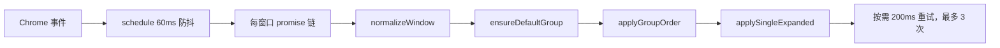

# agent.md

面向修改本仓库的编码代理。用户文档见 [README.md](README.md)。

## 目标与硬约束

- Chrome MV3 扩展，`minimum_chrome_version` 124；无构建步骤、无运行时依赖。
- 权限只有 `tabs`、`tabGroups`、`storage`。`tabs` 仅用于读取 `url` / `pendingUrl` 做新标签页分类。
- **永远不要存储、记录或发送 URL。** 固定分组快照只允许分组 ID、窗口 ID、标题、颜色、折叠状态、标签页 ID 和时间戳。
- `src/lib/*.js` 必须是纯函数，不调用 `chrome.*`；所有 Chrome API 调用集中在 `src/background.js` 和两个 UI 页面。
- 设置写入统一走后台：UI 发送 `{type:"save-settings", patch}`，由后台校验、必要时重命名默认分组，再写 `chrome.storage.sync.settings`。
- 用户可见文案使用中文；代码标识符和注释使用英文。
- 改完运行 `npm test`。脚本是 `node --test test/*.test.js`（Node 24 不接受裸 `test/` 目录参数）。

## 文件地图

| 文件 | 职责 |
| --- | --- |
| `manifest.json` | 权限、service worker module、选项页、弹窗、图标 |
| `icons/icon.svg` + PNG | 扩展图标源文件，改图后重新导出 16/32/48/128 |
| `src/background.js` | 事件接线、逐窗口串行归一化、启动门、固定分组保护、设置写入 |
| `src/lib/layout.js` | `planGroupOrder`、`planCollapse`、`planNewTabTarget`、默认分组查找、NTP URL 判定 |
| `src/lib/pinned.js` | `isPinnedTitle`、`choosePinnedRestore`（`skip` / `regroup` / `blank`） |
| `src/lib/settings.js` | 默认值、标题/颜色/钉住列表校验、`loadSettings` / `saveSettings` |
| `src/options.*` | 行为开关、默认分组、钉住列表增删排序、“立即整理” |
| `src/popup.*` | 分组数、当前分组、总开关、“立即整理”、“设置” |
| `test/*.test.js` | 纯逻辑回归测试 + `background.test.js`（fake chrome，覆盖真实事件接线） |

## 必须维持的不变量

归一化完成后，每个普通窗口满足：

1. 钉住分组按配置顺序在最前；其余分组按当前顺序紧随；未分组标签页在所有分组之后。
2. 除固定标签页外，没有 `groupId === -1` 的标签页（`defaultGroup` 开启时）。
3. 恰好一个分组展开：活动标签页的分组；活动标签页是固定标签页时，`keepLastWhenPinned` 开启则为上次/最近使用的分组，否则全部折叠。
4. 新标签页按规则进入展开分组；Chrome 已归组的链接标签页不被抢走。
5. 钉住分组不会变空：最后一个标签页消失后以空白 NTP 重建，除非窗口正在关闭或分组被移动到其他窗口。

## 运行时结构



- 所有变更事件只调用 `schedule(windowId)`；`enqueue` 保证同一窗口串行。每一步都重新查询 tabs/groups，之前拿到的 ID 一律视为可能过期。
- `planGroupOrder` 的移动规则：先算出期望顺序，然后**逆序**把每个分组 `tabGroups.move(id, {index: pinnedCount})`。这样最终顺序正确，且所有分组位于未分组标签页之前。`pinnedCount` 是固定标签页数量，永远是一个合法插入点。
- `chrome.tabs.group` 绝对不能收到固定标签页：源码文档明确会把它取消固定。`ensureDefaultGroup` 已过滤。
- Chrome 会自动展开包含活动标签页的分组，不要试图折叠它。
- `chrome.tabGroups.query` 返回顺序不代表标签栏顺序；判断顺序必须用各分组标签页的最小 `index`（这也是测试陷阱）。
- 用户点击已展开分组的标题时，Chrome 可能先激活固定标签页再折叠分组；`keepLastWhenPinned` 的普通逻辑会把分组重新展开。三种模式统一在 collapse 事件后接管，且不读取 pinned 状态：`headerNewTab`（关闭占位页后组内新建并激活 NTP）、`headerCollapseToDefault`（非默认组收起、默认组展开并激活 MRU；默认组/无默认组走保持逻辑）、`keepGroupExpandedAfterCollapse`（重新展开并激活原组 MRU）。
- 外部程序新标签页在 Chrome 157 带有 `openerTabId`（指向当时活动页），不能按链接标签页跳过；仍由 `externalNewTabInActiveGroup` 决定。
- `tabs.onUpdated` 必须同时处理 `groupId` 和 `pinned`：固定标签页不属于分组，取消固定后 groupId 仍是 -1，只有 `pinned` 变化事件可用；不调度归一化就会一直留在未分组状态。
- Chrome 在“收起活动分组且无其他可切换标签页（无固定标签页、无其他展开分组）”时会新建一个空白页（`BrowserTabStripController::ToggleTabGroupCollapsedState`）。三种点击行为都只能事后识别并关闭；识别条件见 `findCollapseReplacement`：300ms 内创建、空/NTP URL、活动、未固定、opener 在分组内（不检查当前分组，快速路径可能已把它归组）。`newtab` 模式关闭占位页后只创建自己的目标标签页。
- 内存态（`lastActiveGroupByWindow`、`defaultGroupByWindow`、`collapsedStates`）在 worker 重启后为空；归一化必须能靠标题、`lastAccessed` 和实时查询恢复，不能依赖这些 Map 一定存在。
- 固定分组快照在启动/worker 重启后从实时分组重建；不要信任持久化里可能被复用的 group ID。

## 启动与恢复门

- `boot()` 单飞；顶层、`onStartup`、`onInstalled` 都会触发。
- `chrome.storage.session.bootReady` 缺失时（浏览器新会话），安装临时活动监听器，等到连续 `QUIET_MS = 1500ms` 无事件或 `MAX_BOOT_MS = 30000ms`，再写 `bootReady` 并 `ready = true`。这段时间所有处理器只读。
- 只有在真正走过静默门（浏览器启动/首次安装）时才设置 `warmupUntil = now + 3000ms`。**不要**在 `bootReady` 已存在的 worker 唤醒路径设置它，否则空闲 30 秒后每次点击分组标题都会被吞掉 3 秒。
- `warmupUntil` 期间标题点击不切换标签页，只触发归一化把非活动分组折叠回去。

## 新标签页快路径

`handleCreated` 的顺序不可随意调整：

1. 已就绪、启用、非固定、普通窗口、未被 `ignoreCreatedTabs` 标记。
2. 立即 `claimPendingCreated(tab.id)`，把新标签页从默认分组扫描中排除，直到分类结束。否则 `tabs.onActivated` 触发的 60ms 归一化会抢在 150ms 分类之前把新标签页塞进默认分组——这是实际出现过的 bug。
3. 按窗口统计 300ms 内的创建数量；2 个以上视为会话恢复/批量打开，设置 2s 抑制并跳过。
4. `pendingCreatedChecks` 登记取消标志；等待 150ms；再次检查突发数量和 `ignoreCreatedTabs`；重读标签页。
5. 分类顺序：自身扩展页 → 空 URL 或 NTP URL（总是移动）→ 外部标签页（看 `externalNewTabInActiveGroup`）。不要因为 `openerTabId` 非空就跳过：Chrome 157 的外部启动标签页也会带上当时的活动标签页作为 opener；链接标签页和“在新标签页组中打开”此时已经被 Chrome 归组（`groupId !== -1`），会提前返回。
6. 目标分组来自 `planNewTabTarget`；没有目标时查找或创建默认分组（先按 remembered ID，再按标题），不要重复创建同名默认分组。
7. 分组失败重试一次（200ms），仍失败就交给下一轮归一化的默认分组。

其他状态：

- `ignoreCreatedTabs`（10s）：保护固定分组重建时创建的空白页。
- `burstSuppressUntil`：恢复突发期间不抢标签页。
- 恢复创建的空白页在 `tabs.create` 返回后才拿得到 ID，所以 `handleCreated` 在 150ms 等待后还要再查一次 `ignoreCreatedTabs`。

## 固定分组保护

关键事实：Chrome 没有 `tabGroups.close`，`tabGroups.onRemoved` 不可取消，已保存标签组对扩展不可见。保护=保持非空。

- `pinnedSnapshots: Map<groupId, {windowId,title,color,collapsed,tabIds,updatedAt}>`，100ms 防抖刷新；同时持久化到 `chrome.storage.session.pinnedSnapshots`（不读取，重启靠实时重建）。
- `pendingPinnedTabs: Map<tabId, {expiresAt, origin}>`：刚从钉住分组离开的标签页不参与默认分组；`origin` 用于快照刷新时保留归属，5s TTL 防泄漏。
- `tabs.onRemoved` 先从快照同步删除 ID，再刷新；这样最后一个标签页关闭时快照为空，才能触发空白页。
- `tabs.onUpdated` 的 `groupId` 变化：从旧快照删除；新分组是钉住分组则加入；变为 `-1` 且有 origin 才 `claimPendingPinned`。
- `tabs.onDetached/onAttached` 不立即改快照，等 `onRemoved` 处理完跨窗口移动。
- `tabGroups.onRemoved`：先取快照；非钉住标题/未启用/未就绪直接丢弃；否则等 500ms 让移动和窗口关闭标志稳定。
- 恢复决策用纯函数 `choosePinnedRestore`：窗口关闭或已移动到其他窗口 → `skip`；同窗口存活的未分组标签页 → `regroup`；否则 → `blank`。不要抢其他分组里的存活标签页。
- `restoreLocks` 按 `${windowId}:${groupId}` 防重入；`closingWindows` 5s TTL；`recentGroupCreations` 2s 内识别“移动到新窗口”。
- 拖拽/不可编辑错误：整个恢复最多重试一次（300ms）；重试期间必须保留 pending 声明，否则归一化会把标签页扫进默认分组。所有清理放在 `finally`。
- 空白页创建：`chrome://newtab/`，失败回退 `about:blank`；必须未激活。创建后同时标记 `ignoreCreatedTabs` 和 pending，再归组。
- 标题是唯一身份：精确、区分大小写；同名分组全部钉住。重命名即失去钉住；无标题分组不可钉住。

## 设置与 UI

- 单一存储键：`chrome.storage.sync.settings`。`normalizeSettings` 合并默认值、裁剪标题到 30 字符、校验九种颜色、钉住列表去空/去重/上限 50。
- 后台 `save-settings` 在写存储前先重命名各窗口的默认分组（先 remembered ID，再旧标题匹配），避免设置切换后旧标题分组被当成普通分组。
- 选项页保存后立即 `refresh`，`chrome.storage.onChanged` 也会刷新；不要把设置写进本地副本。
- 选项页钉住列表顺序即标签栏顺序；上/下移动、取消钉住都发送完整 `pinnedGroups` 数组。“取消钉住”不会关闭 Chrome 分组。
- 弹窗只做只读统计 + 总开关 + 两个按钮；不要在弹窗复制完整设置。
- `chrome.runtime.sendMessage` 从 service worker 发给自己不会触发自身的 `onMessage`；需要内部触发时用 `chrome.storage` 变更或从扩展页面发送。


## 点击已展开分组标题：行为矩阵

`expandedGroupHeaderClick` 三选一。选组与焦点结果都不读取 pinned 状态。

| 点击对象 | `newtab` | `collapse` | `noaction` |
| --- | --- | --- | --- |
| 非默认组 G，默认组存在 | 关闭占位页；G 内新建并激活 NTP；G 展开 | G 收起；默认组展开并激活其 MRU 标签页 | G 保持展开并激活其 MRU 标签页 |
| 默认组 G，其他组存在 | 关闭占位页；G 内新建并激活 NTP；G 展开 | 不做分组变更；G 保持展开并激活其 MRU 标签页 | 同 `collapse` 的默认组列 |
| 非默认组 G，无默认组 | 关闭占位页；G 内新建并激活 NTP；G 展开 | 无默认组可展开，按 `noaction` 处理 | G 保持展开并激活其 MRU 标签页 |
| 唯一分组 G（默认或非默认） | 同第一行 | 按 `noaction` 处理 | 同左 |
| pinned 为无 / 非活动 / 活动 | 结果相同；活动标签页是新建 NTP | 结果相同；活动标签页是目标组 MRU | 结果相同；活动标签页是原组 MRU |

补充规则：

- “MRU 标签页”按 `lastAccessed` 降序，平局取 `index` 最小。
- 默认组按 `defaultGroupTitle` 精确匹配；多个同名默认组取标签栏顺序中的第一个（选择逻辑只用于 `collapse`）。
- `collapse` 只在默认组有标签页时生效；空组不存在，因此“有默认组”即“默认组有标签页”。
- 所有模式都会关闭 Chrome 的占位页；`newtab` 额外创建一个组内 NTP。
- `keepLastWhenPinned` 只影响普通激活固定标签页，不影响上述三种点击行为。
- `expandHeaderClick` 只影响点击**折叠**分组标题，不影响已展开分组。

## 修改后的回归清单

```bash
npm test
```

再加载已解压扩展（专用 profile）手动核对：

1. 固定标签页 + A/B 分组 + 未分组标签页 → 默认分组建立、分组在前、只展开一个。
2. 点击折叠分组标题 → 切到该分组最近标签页；关闭该开关后 → 分组重新折叠。
3. A 分组活动时 Ctrl+T → 新标签页在 A 末尾；固定标签页活动且 `keepLastWhenPinned` 开关两种状态。固定任意标签页后再取消固定 → 该标签页进入默认分组；有/无其他固定标签页各验证一次。
4. 按“行为矩阵”逐项验证三种 `expandedGroupHeaderClick`：多个组 + 默认组、无默认组、点击默认组、唯一组；每种都在 pinned 无/非活动/活动下点击一次，确认分组与活动标签页一致；`newtab` 模式确认只多出一个组内 NTP（占位页被关闭）。
5. 页面链接 Ctrl+点击 / `window.open` → 不抢标签页；外部程序打开（终端 `open`/命令行，注意其 opener 非空）→ 开关生效，打开后进入当前展开分组。
6. 钉住 A 后关闭最后一个标签页 → 空白 NTP 重建；取消分组 → 原标签页归组；移动分组到新窗口 / 关闭窗口 → 不补空白。
7. 取消钉住后删除 → 不再重建；Chrome 中重命名 → 失去钉住。
8. 开启“继续浏览上次打开的网页”后重启 → 分组/标题/颜色/顺序/单展开全部保持。
9. 关闭总开关 → 激活、创建、取消分组都不被改写，固定分组保护停止；重新开启后收敛。

检查扩展页 `chrome://extensions` 无 runtime error；不要把 URL 加进日志来“调试分类”。

## 已踩过的坑

- 新标签页默认分组竞态：`onActivated` 的归一化快于 150ms 分类 → `pendingCreatedTabs`。
- 标题点击激活与折叠竞态：60ms 归一化会在 120ms 切换前折叠分组 → `headerActivationUntil`（1s，激活成功后立即清除）。
- worker 每次唤醒都设 warmup 会吞掉标题点击 → 只在静默启动门后设置。
- 恢复重试时提前释放 pending → 标签页被默认分组抢走 → 重试必须在 `finally` 清理之前完成。
- `tabGroups.query` 顺序不是标签栏顺序 → 测试用最小标签页 `index` 计算。
- 把固定标签页传给 `tabs.group` 会取消固定。
- CDP/开发者模式重载不可靠时，`chrome.runtime.reload()` 可能把 unpacked 扩展置为 disabled；从 `chrome://extensions` 重新加载，必要时重新 `Extensions.loadUnpacked`。
- `chrome.storage.session` 在浏览器重启后清空；`bootReady` 因此天然区分“新浏览器会话”和“worker 被回收”。
